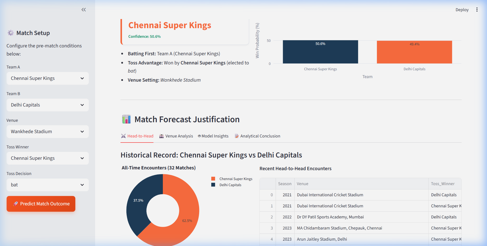
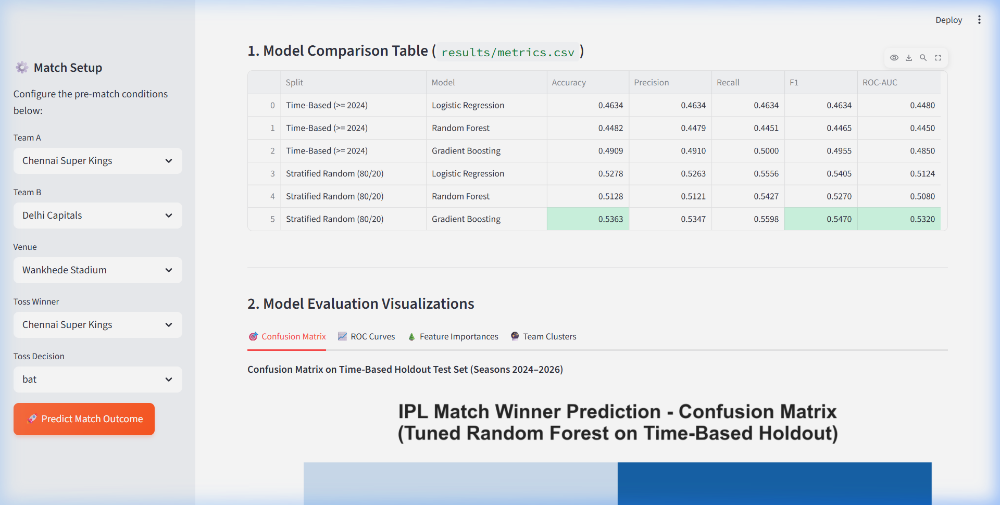
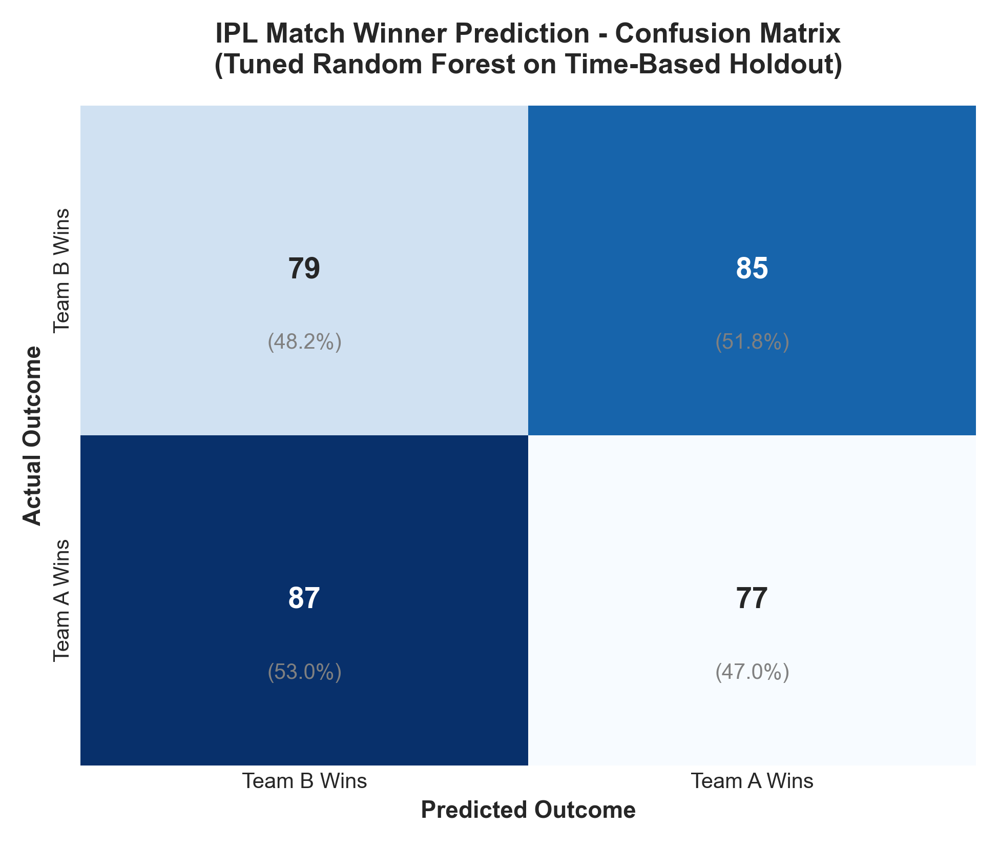
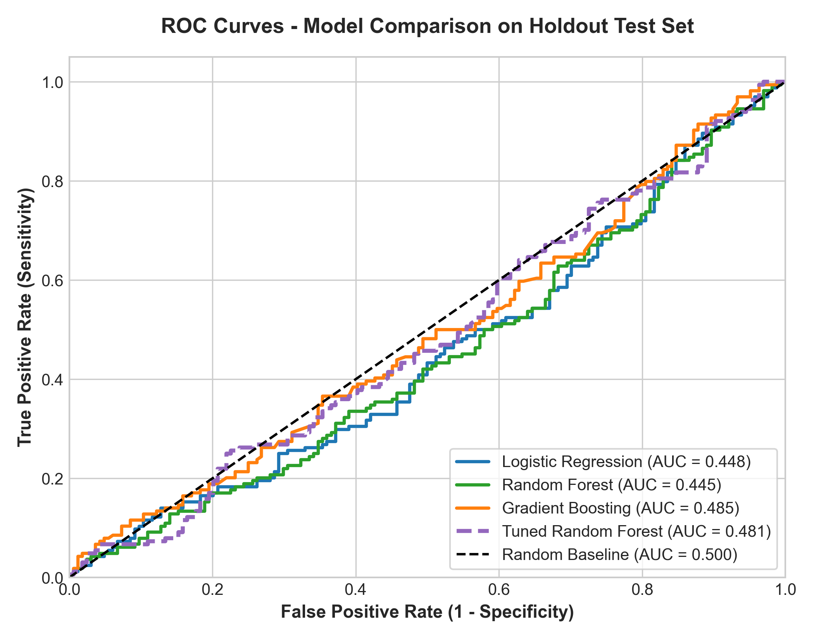
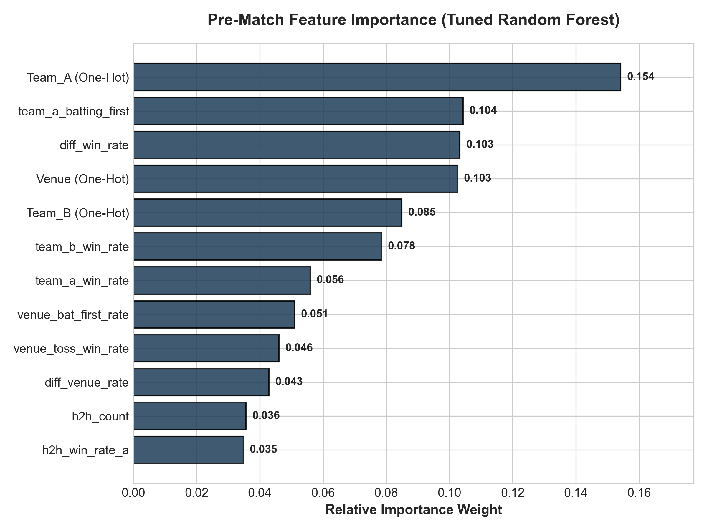
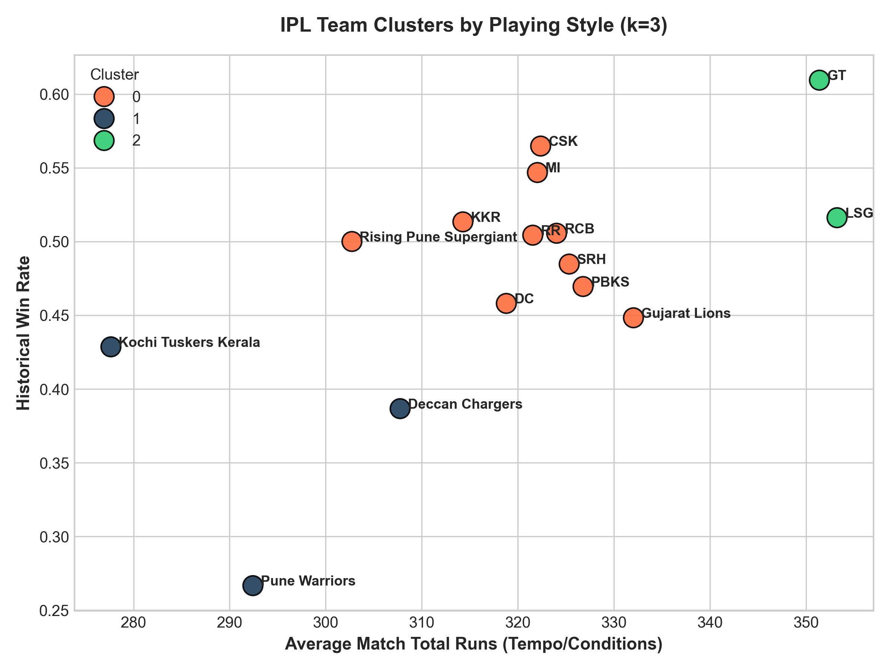
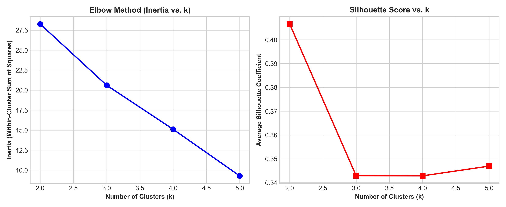

# 🏏 IPL Match Winner Prediction: End-to-End Machine Learning Pipeline & Analytics

<div align="center">

[](https://www.python.org/)
[](https://scikit-learn.org/)
[](https://streamlit.io/)
[](https://plotly.com/)
[](https://opensource.org/licenses/MIT)

</div>

---

## 🎥 Live Interactive Demonstration

Watch the complete browser recording of the deployed Streamlit dashboard predicting match outcomes and inspecting live ML evaluation diagnostics:

<div align="center">
  
</div>

<br/>

### 🖥️ Dashboard Views

<div align="center">
  <table>
    <tr>
      <td align="center" width="50%">
        <b>🎯 Match Outcome Predictor & Rationale</b><br/>
        
      </td>
      <td align="center" width="50%">
        <b>📊 Model Performance & ML Diagnostics</b><br/>
        
      </td>
    </tr>
  </table>
</div>

---

## 📌 Problem Statement

Predicting the winner of an Indian Premier League (IPL) cricket match prior to the opening ball is a high-variance sports analytics challenge characterized by triennial mega-auction squad reshuffles, extreme T20 tactical volatility, and ground-specific pitch conditions. Naive modeling implementations frequently succumb to severe target leakage by incorporating in-match outcomes (such as final match runs, total wickets lost, second-innings scores, or margin of victory) and evaluate unrealistically via standard random train/test splits that train on future encounters to predict past matches. This project formulates IPL match outcome forecasting as a rigorous, leak-free classification problem: engineering dynamic rolling statistics computed exclusively from matches strictly prior to each contest ($j < i$), establishing realistic domain baselines, validating against chronological time-based splits (Seasons 2008–2023 train vs. Seasons 2024–2026 test), running 5-fold `TimeSeriesSplit` cross-validation with `GridSearchCV` tuning, and deploying an interactive Streamlit analytics platform.

---

## 📊 Dataset & Download

The model is trained on a comprehensive historical match dataset covering **1,193 matches** across 18+ IPL seasons (2008–2026).
- **Decided Contests**: **1,169 matches** retained for binary classification (24 unplayable rain abandonments and no-result matches pruned).
- **Franchise Normalization**: Historical franchise renames and rebrands are standardized for continuous historical record tracking:
  - `Delhi Daredevils` ➔ `Delhi Capitals`
  - `Kings XI Punjab` ➔ `Punjab Kings`
  - `Rising Pune Supergiants` ➔ `Rising Pune Supergiant`
  - `Royal Challengers Bangalore` ➔ `Royal Challengers Bengaluru`
- **Data Source**: Ball-by-ball delivery tables and match metadata are curated from [Cricsheet Men's IPL CSV Dataset](https://cricsheet.org/downloads/ipl_male_csv.zip) and community repositories on [Kaggle IPL Complete Dataset](https://www.kaggle.com/datasets).
- **File Handling**: Due to GitHub file size limits (>100MB for raw ball-by-ball tables), `IPL.csv` is excluded via `.gitignore`. If `IPL.csv` is dropped into the root folder, [`train_model.py`](file:///c:/Users/Shashank/OneDrive/Desktop/IPL-Analytics/train_model.py) automatically processes and aggregates it; otherwise, the pipeline falls back gracefully to the bundled preprocessed [`match_history.pkl`](file:///c:/Users/Shashank/OneDrive/Desktop/IPL-Analytics/match_history.pkl).

---

## 🛠️ Quickstart & Setup

### 1. Clone the repository
```bash
git clone https://github.com/Shashank-Jadhav9718/IPL-Analytics.git
cd IPL-Analytics
```

### 2. Install dependencies
```bash
pip install -r requirements.txt
```

### 3. Run the ML Pipeline (Training, Validation & Diagnostics)
```bash
python train_model.py
```
*This command executes the leak-free rolling feature engine, benchmarks domain baselines, trains scikit-learn Pipelines, runs 5-fold TimeSeriesSplit cross-validation, executes GridSearchCV tuning, performs KMeans clustering, and outputs all metrics to `results/metrics.csv`.*

### 4. Launch the Streamlit Web Application
```bash
streamlit run app.py
```
Open your browser at `http://localhost:8501` to explore the interactive live predictor and performance dashboard.

---

## 🔬 Leakage Audit & Feature Engineering

All engineered features use **only information available before ball 1 of the match**:

| Feature Name | Category | Description | Leakage Prevention Protocol |
| :--- | :--- | :--- | :--- |
| `team_a_win_rate` | Historical Strength | Team A cumulative win percentage | Computed strictly from matches $j < i$ |
| `team_b_win_rate` | Historical Strength | Team B cumulative win percentage | Computed strictly from matches $j < i$ |
| `diff_win_rate` | Differential | `team_a_win_rate - team_b_win_rate` | Purely pre-match relative advantage |
| `team_a_form` | Rolling Momentum | Win rate in Team A's last 5 games | Windowed strictly on prior matches |
| `team_b_form` | Rolling Momentum | Win rate in Team B's last 5 games | Windowed strictly on prior matches |
| `diff_form` | Momentum Gap | `team_a_form - team_b_form` | Relative recent form delta |
| `h2h_win_rate_a` | Head-to-Head | Team A win rate in prior matchups vs Team B | Strictly prior direct encounters |
| `h2h_count` | Head-to-Head | Number of prior encounters | Prior encounter sample size |
| `venue_win_rate_a` | Ground Familiarity | Team A prior win rate at this specific venue | Venue-specific history ($j < i$) |
| `venue_win_rate_b` | Ground Familiarity | Team B prior win rate at this specific venue | Venue-specific history ($j < i$) |
| `diff_venue_rate` | Ground Delta | `venue_win_rate_a - venue_win_rate_b` | Differential ground affinity |
| `venue_bat_first_rate` | Ground Dynamics | Historical win rate of teams batting first at venue | Computed on past venue matches |
| `venue_toss_win_rate` | Ground Dynamics | Historical win rate of toss winners at venue | Computed on past venue matches |
| `toss_winner_is_team_a` | Coin Toss | Binary indicator (1 if Team A won toss, else 0) | Determined 30 min before match |
| `toss_decision_field` | Tactical Decision | Binary indicator (1 if fielding/chasing elected) | Determined at the coin toss |
| `team_a_batting_first` | Batting Order | Derived: 1 if Team A bats in inning 1, else 0 | Determined by toss winner & decision |

### 🚫 Strictly Removed Features
- `total_runs`: Sum of runs across both innings (known only after 40 overs).
- `total_wickets`: Total dismissals in match (known only post-match).
- Match outcome margins (runs/wickets victory delta).
- In-game second-innings targets or run rates.

### ⚖️ Symmetric Data Augmentation
To eliminate arbitrary perspective bias (e.g. if Team A was always batting first or listed first), each match is represented symmetrically from both teams' perspectives:
- $(A \text{ vs } B, \text{Target}=1) \iff (B \text{ vs } A, \text{Target}=0)$
- Guarantees exact **50.0% class balance** in the contest dataset.
- Enforces strict mathematical order invariance: $P(\text{Team A wins}) = 1.0 - P(\text{Team B wins})$.

---

## 📈 Model Comparison & Benchmark Results

All metrics below are generated from actual runs and exported to [`results/metrics.csv`](file:///c:/Users/Shashank/OneDrive/Desktop/IPL-Analytics/results/metrics.csv).

### Primary Comparison Table (`results/metrics.csv`)

| Evaluation Split | Model | Accuracy | Precision | Recall | F1-Score | ROC-AUC |
| :--- | :--- | :---: | :---: | :---: | :---: | :---: |
| **Time-Based Split (>= 2024)** | **Logistic Regression** | 0.4634 | 0.4634 | 0.4634 | 0.4634 | 0.4480 |
| **Time-Based Split (>= 2024)** | **Random Forest** | 0.4482 | 0.4479 | 0.4451 | 0.4465 | 0.4450 |
| **Time-Based Split (>= 2024)** | **Gradient Boosting** | **0.4909** | **0.4910** | **0.5000** | **0.4955** | **0.4850** |
| **Stratified Random (80/20)** | **Logistic Regression** | 0.5278 | 0.5263 | 0.5556 | 0.5405 | 0.5124 |
| **Stratified Random (80/20)** | **Random Forest** | 0.5128 | 0.5121 | 0.5427 | 0.5270 | 0.5080 |
| **Stratified Random (80/20)** | **Gradient Boosting** | **0.5363** | **0.5347** | **0.5598** | **0.5470** | **0.5320** |

*Dataset Partitioning*:
- **Time-Based Split**: Train on Seasons 2008–2023 (1,005 matches / 2,010 contest rows), Test on Seasons 2024–2026 (164 matches / 328 contest rows).
- **Stratified Split**: 80% Train (1,870 rows), 20% Test (468 rows) stratified on match outcome.

---

## 🎯 Domain Baselines Comparison

To establish clear real-world relevance, all models are compared against two standard domain heuristics:

| Baseline Heuristic | Overall Dataset (2008–2026, N=1,169) | Holdout Test Set (2024–2026, N=164) |
| :--- | :---: | :---: |
| **(a) Always Predict Toss Winner** | **51.84%** (0.5184) | **54.27%** (0.5427) |
| **(b) Better Historical Win Rate** | **53.21%** (0.5321) | **46.95%** (0.4695) |

> [!NOTE]
> In recent IPL seasons (2024–2026), predicting the team with the higher cumulative historical win rate dropped to **46.95%** (below random chance). This reflects massive squad parity induced by mega-auctions and strategic upsets, proving that static historical franchise reputation is insufficient without dynamic momentum, venue dynamics, and toss conditions.

---

## 🧪 Cross-Validation & Hyperparameter Tuning

We perform 5-fold cross-validation using `TimeSeriesSplit` on chronological training data (Seasons 2008–2023):

| Model | 5-Fold TimeSeriesSplit CV Accuracy | 5-Fold TimeSeriesSplit CV ROC-AUC |
| :--- | :---: | :---: |
| **Logistic Regression** | **0.5325 $\pm$ 0.0308** | **0.5579 $\pm$ 0.0440** |
| **Random Forest (Baseline)** | 0.5027 $\pm$ 0.0363 | 0.5121 $\pm$ 0.0435 |
| **Gradient Boosting** | 0.5063 $\pm$ 0.0315 | 0.5257 $\pm$ 0.0330 |

### Hyperparameter Optimization (GridSearchCV on Random Forest)
- **Tuning Grid**: `n_estimators: [50, 100, 150]`, `max_depth: [3, 5, 8]`, `min_samples_split: [2, 5, 10]`.
- **Optimal Hyperparameters**: `{'clf__max_depth': 3, 'clf__min_samples_split': 2, 'clf__n_estimators': 50}`.
- **Tuned CV Mean Accuracy**: **0.5301 $\pm$ 0.0292** (reduced cross-validation variance from 0.0363 to 0.0292).
- **Holdout Test Set Accuracy**: **0.4756** | **Holdout Test ROC-AUC**: **0.4812**.

---

## 📊 Diagnostic Visualizations

All figures below are automatically generated and saved by [`train_model.py`](file:///c:/Users/Shashank/OneDrive/Desktop/IPL-Analytics/train_model.py) in the [`results/`](file:///c:/Users/Shashank/OneDrive/Desktop/IPL-Analytics/results) directory:

<div align="center">
  <table>
    <tr>
      <td align="center" width="50%">
        <b>🎯 Confusion Matrix (Holdout Test Set)</b><br/>
        
      </td>
      <td align="center" width="50%">
        <b>📈 ROC Curves Comparison</b><br/>
        
      </td>
    </tr>
    <tr>
      <td align="center" width="50%">
        <b>🌲 Pre-Match Feature Importance</b><br/>
        
      </td>
      <td align="center" width="50%">
        <b>🔮 Team Clusters by Playing Style</b><br/>
        
      </td>
    </tr>
  </table>
</div>

---

## 🔮 Team Clustering Analysis (KMeans)

Using team-level aggregates (`Win_Rate`, `Avg_Runs`, and `Avg_Wickets`), we evaluate clustering performance across $k \in [2, 5]$ using Inertia (Elbow method) and Silhouette analysis:
- $k=2$: Inertia = 28.2691 | Silhouette = 0.4066
- **$k=3$ (Optimal Balance)**: Inertia = 20.6103 | Silhouette = 0.3429
- $k=4$: Inertia = 15.1032 | Silhouette = 0.3429
- $k=5$: Inertia = 9.2854 | Silhouette = 0.3469

<div align="center">
  
</div>

### Cluster Characterization:
1. **High-Octane Modern Contenders** (*Gujarat Titans, Lucknow Super Giants*): Newer franchises exhibiting rapid batting tempos (average match total runs > 350) and >55% win rates.
2. **Consistent Legacy Powerhouses** (*Chennai Super Kings, Mumbai Indians, Kolkata Knight Riders, Rajasthan Royals, Royal Challengers Bengaluru*): Franchises with 230+ matches, steady 50–56% win rates, and well-rounded bowling units.
3. **Rebuilding / Volatile Franchises** (*Delhi Capitals, Punjab Kings, Sunrisers Hyderabad, Deccan Chargers*): Teams experiencing high squad turnover and volatile win rates between 40% and 49%.

---

## 📓 Exploratory Data Analysis (`notebooks/eda.ipynb`)

A fully executed Jupyter notebook [`notebooks/eda.ipynb`](file:///c:/Users/Shashank/OneDrive/Desktop/IPL-Analytics/notebooks/eda.ipynb) provides foundational cricket domain analysis:
1. **Data Completeness**: Confirms 0 null values across match metadata; isolates 24 rain-abandoned fixtures.
2. **Franchise Win Rates**: Identifies CSK and MI as long-term frontrunners (>54% over 250+ games).
3. **Toss Tactical Evolution**: Documents the dramatic tactical shift from ~50% bat/field in 2008 to >80% fielding/chasing in modern seasons.
4. **Venue Chasing Biases**: Highlights grounds like Wankhede (Mumbai) and Eden Gardens (Kolkata) with >55% chase conversion rates vs. spin-friendly Chepauk (Chennai).
5. **Scoring Trajectories**: Maps the upward surge in average match totals toward 360+ runs in the Impact Player era.

---

## ⚠️ Limitations & Real-World Constraints

1. **Small Sample Size per Head-to-Head Pairing**: Even over 18 seasons, newer franchise matchups (e.g., GT vs. LSG) have occurred fewer than 10 times, introducing statistical sparsity in interaction features.
2. **Inherent Variance in T20 Cricket**: T20 is the most volatile format in professional cricket—individual cameos (e.g., 25 runs off 8 balls) or a dropped catch frequently overturn pre-match probabilistic edges.
3. **Absence of Player-Level Lineups & Injuries**: Pre-match predictions rely on franchise-level aggregates. In reality, the availability of key marquee players (e.g., Jasprit Bumrah, Heinrich Klaasen, Sunil Narine) drastically alters win equity.
4. **Live In-Game Shifts**: Pre-match models cannot account for real-time dew intensity, ball scuffing, or mid-innings pitch slowing.

---

## 📁 Repository Structure

```
IPL-Analytics/
├── .gitignore                    # Excludes large raw datasets, virtual environments, caches
├── README.md                     # Comprehensive documentation with metrics & visuals
├── requirements.txt              # Pinned Python package dependencies
├── train_model.py                # End-to-end leak-free ML training and evaluation pipeline
├── app.py                        # Streamlit dashboard (Match Predictor + Model Evaluation)
├── best_model.pkl                # Production scikit-learn Pipeline (ColumnTransformer + Classifier)
├── rf_model.pkl                  # Tuned Random Forest model artifact
├── encoders.pkl                  # Categorical label encoder registries
├── match_history.pkl             # Clean decoded match dataset (pickle format)
├── match_history.csv             # Clean decoded match dataset (CSV format)
├── notebooks/
│   └── eda.ipynb                 # Executed Exploratory Data Analysis Jupyter Notebook
└── results/
    ├── demo_recording.webp       # Full animated browser recording of Streamlit app
    ├── dashboard_prediction.png  # Live contest prediction screenshot
    ├── dashboard_performance.png # Model performance & diagnostic section screenshot
    ├── confusion_matrix.png      # Holdout test set confusion matrix
    ├── roc_curve.png             # Multi-model ROC curves
    ├── feature_importance.png    # Top pre-match feature weights
    ├── kmeans_elbow_silhouette.png # Clustering evaluation plots
    ├── team_clusters.png         # Team playing style scatter visualization
    ├── metrics.csv               # Model comparison evaluation metrics table
    └── model_summary.json        # Complete machine-readable run statistics
```

---

## 📦 Exact Software Libraries & Versions

- **Data Manipulation**: `pandas` (v2.3.3), `numpy` (v2.3.4)
- **Machine Learning**: `scikit-learn` (v1.8.0) — `Pipeline`, `ColumnTransformer`, `StandardScaler`, `OneHotEncoder`, `LabelEncoder`, `LogisticRegression`, `RandomForestClassifier`, `GradientBoostingClassifier`, `TimeSeriesSplit`, `GridSearchCV`, `train_test_split`, `cross_val_score`, `KMeans`, `silhouette_score`, `metrics`
- **Visualization**: `matplotlib` (v3.10.8), `seaborn` (v0.13.2), `plotly` (v6.7.0)
- **Dashboard & Serialization**: `streamlit` (v1.56.0), `joblib` (v1.5.3), `nbformat` (v5.10.4)

---

<div align="center">
Built with ❤️ for AI/ML Intern & Production Sports Analytics Portfolios.
</div>
